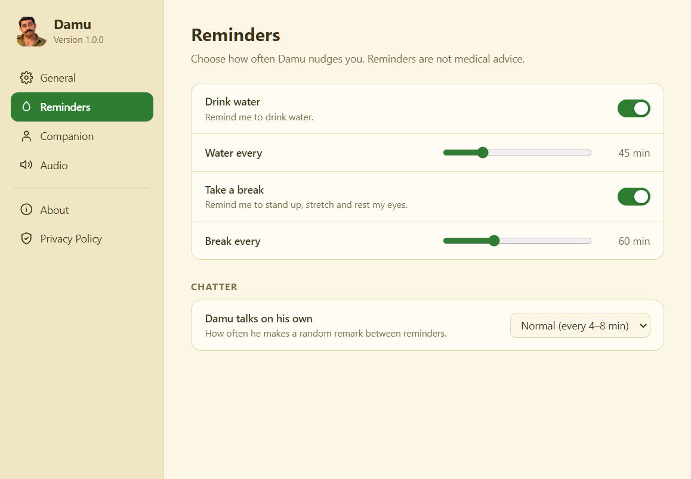

<div align="center">


# Damu

**A friendly desktop companion that reminds you to drink water and take breaks.**

[](https://github.com/abidkakkur11/damu-companion/actions/workflows/ci.yml)
[](https://github.com/abidkakkur11/damu-companion/releases)
[](LICENSE)


</div>

Damu is a small animated character who wanders around your desktop, nudges you to drink water and
stretch, and reacts when you click or drag him. He speaks in Malayalam and plays short voice clips.
Everything runs locally: no accounts, no telemetry, no network access.

<p align="center">
  
</p>

## Features

- **Reminders:** water and break reminders, each with its own on/off switch and interval.
- **Lively companion:** walks, stands, looks around, hops and reacts to clicks, double-clicks and dragging.
  He sometimes walks off-screen and comes back with a question.
- **Voice clips:** random clips per event (greeting, reminders, clicks, chatter).
- **Full control:** a Settings window for reminder intervals, chatter frequency, walking speed, size,
  audio and more. Changes apply instantly.
- **Show or hide:** switch him off and he walks out of the screen; switch him on and he walks back in.
- **Tray icon:** quick access to settings, pause, sound and quit.
- **Private by design:** nothing is collected or sent anywhere. See the [privacy notes](#privacy).

## Install

Download `Damu Setup <version>.exe` from the [latest release](https://github.com/abidkakkur11/damu-companion/releases/latest)
and run it. Windows may show an "unknown publisher" warning because the installer is not code-signed.

Requires Windows 10 or 11 (64-bit).

## Using Damu

Damu sits on top of your windows and never blocks them: clicks pass straight through everywhere except on Damu himself.

- **Open Settings:** click the Damu tray icon (it may be under the `^` arrow next to the clock).
- **Quit:** right-click the tray icon and choose **Quit Damu**. Closing the Settings window does not quit.
- **Interact:** click him, double-click him, or drag him along the bottom of the screen.

<details>
<summary>More screenshots</summary>

| Reminders | Companion | Audio |
| --- | --- | --- |
|  |  |  |

</details>

## Settings

| Page | What you can change |
| --- | --- |
| General | Show Damu, start with Windows, pause all reminders, test buttons, reset to defaults |
| Reminders | Water and break on/off and interval (1-180 min), chatter frequency |
| Companion | Walking speed (0.4x-2.5x), size (60%-160%), off-screen trips |
| Audio | Master switch, volume, sounds for reminders, chatter and reactions, test sound |
| About | Version, author, licence |
| Privacy Policy | What Damu stores and what it never does |

Settings are saved to `settings.json` in the app's data folder (`%APPDATA%\damu-companion`).

## Customising the voice clips

Put `.wav` files in [`assets/audio/`](assets/audio) and list them under an event in the `SOUNDS` table at the top of
[`src/companion.js`](src/companion.js). Each event plays a random clip from its list and never repeats the same clip twice in a row.

| Event | Plays when |
| --- | --- |
| `intro` | Damu greets you on launch |
| `remind` | A water or break reminder appears |
| `click` / `dblclick` | You click or double-click him |
| `returned` | He comes back from an off-screen trip |
| `chatter` | He makes a random remark |

## Development

Requirements: [Node.js](https://nodejs.org/) 20 or newer.

```bash
git clone https://github.com/abidkakkur11/damu-companion.git
cd damu-companion
npm install
npm start
```

| Command | What it does |
| --- | --- |
| `npm start` | Run Damu in development |
| `npm run check` | Syntax-check the source files |
| `npm run pack` | Build an unpacked app in `dist/win-unpacked/` |
| `npm run dist` | Build the Windows installer in `dist/` |
| `npm run icon` | Regenerate `assets/icon.ico` from `assets/icon.png` |

**Troubleshooting**

- `Cannot read properties of undefined (reading 'requestSingleInstanceLock')` on start: the environment variable
  `ELECTRON_RUN_AS_NODE` is set. Unset it and try again.
- Only one Damu runs at a time. If a launch seems to do nothing, quit the running copy from the tray first.
  Launching a second time opens Settings.

### Project structure

```
src/
  main.js             Main process: tray, windows, settings storage, reminder timers
  companion.html/js   Transparent overlay: animation, behaviour, audio
  settings.html/js    Settings window
  preload*.js         Secure bridges between processes and windows
assets/               Poses, walk frames, faces, voice clips, icons
scripts/              Asset pipeline and packaging helpers
docs/screenshots/     Images used in this README
```

### Releasing

Bump `version` in `package.json`, update [`CHANGELOG.md`](CHANGELOG.md), then push a tag such as `v1.0.0`.
The [release workflow](.github/workflows/release.yml) builds the installer and attaches it to a GitHub release.

## Privacy

Damu collects no data and makes no network connections. The only thing it saves is your preferences, locally.
It never takes screenshots, logs keystrokes or reads your files. The full policy is in the app under
**Settings > Privacy Policy**.

## Contributing

Issues and pull requests are welcome. See [CONTRIBUTING.md](CONTRIBUTING.md).

## License

Released under the [MIT License](LICENSE). Copyright (c) 2026 abidkakkur11.

Reminders are friendly nudges, not medical advice.
