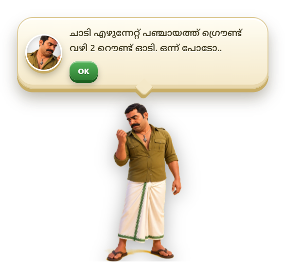
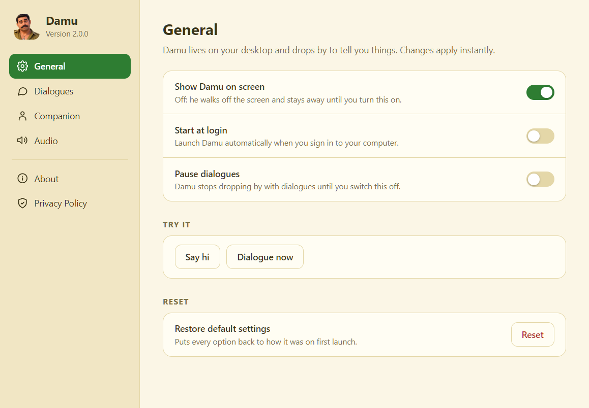
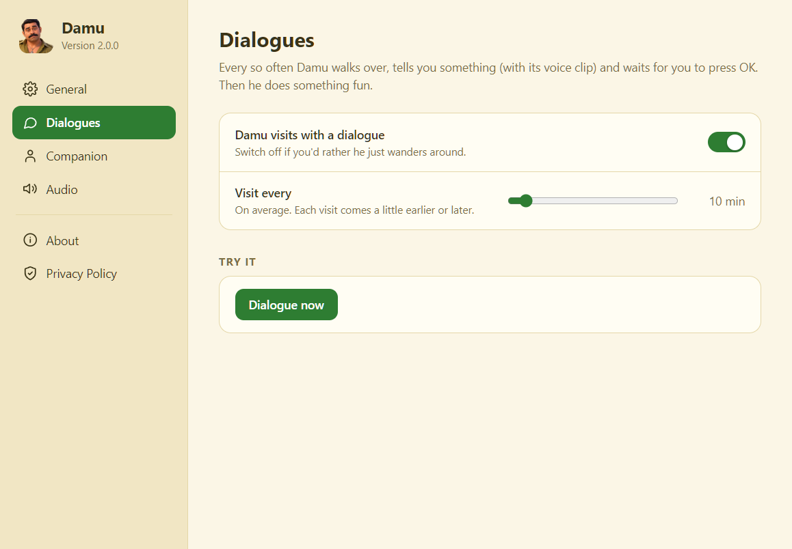
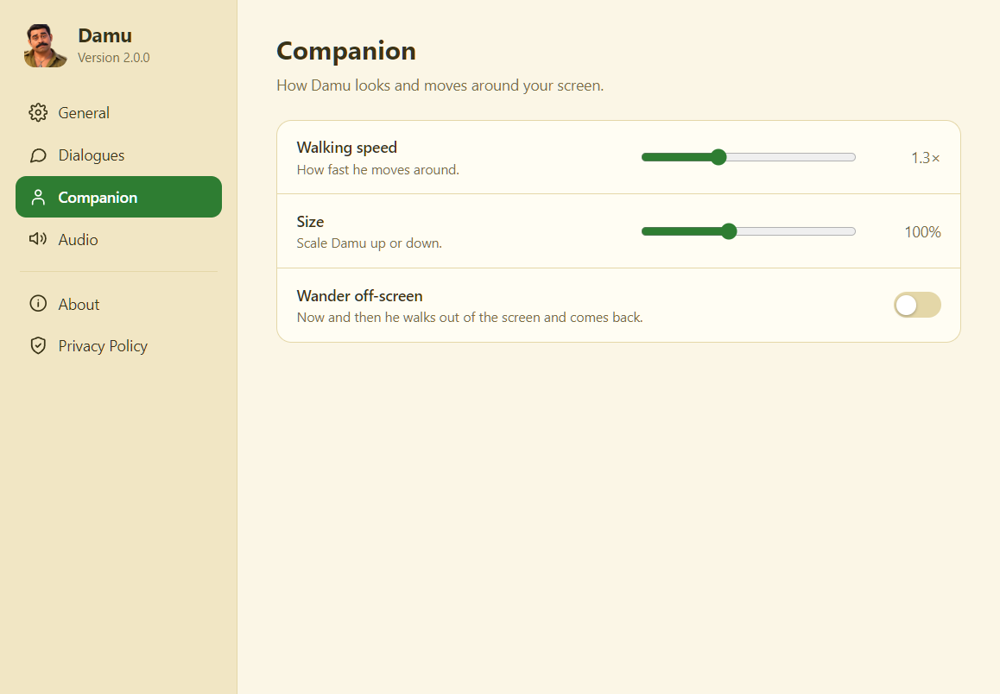
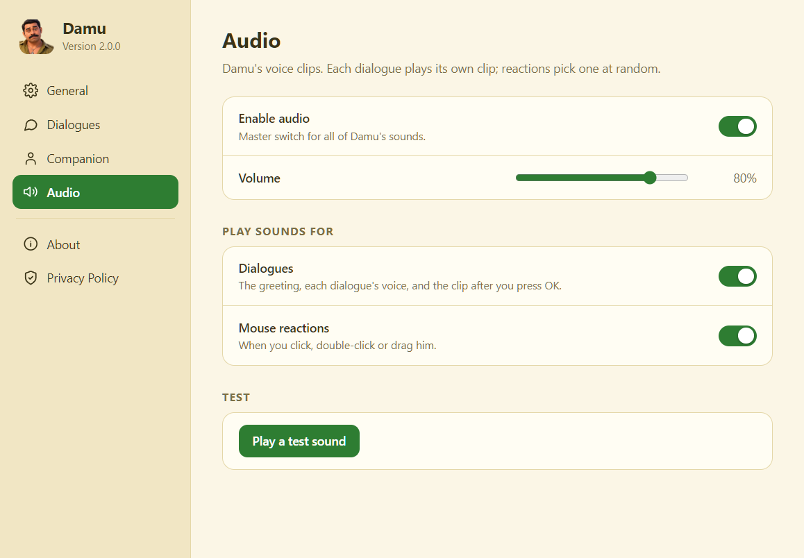

<div align="center">


# Damu

**A desktop companion who walks onto your screen, tells you something, and does a little dance when you say OK.**

[](https://github.com/abidkakkur11/damu-companion/actions/workflows/ci.yml)
[](https://github.com/abidkakkur11/damu-companion/releases)
[](LICENSE)

[](https://github.com/abidkakkur11/damu-companion/releases)
[](https://buymeacoffee.com/abidkp)

**[Website](https://abidkakkur11.github.io/damu-companion/)** · **[Download](https://github.com/abidkakkur11/damu-companion/releases/latest)** · **[Changelog](CHANGELOG.md)** · **[Contribute](CONTRIBUTING.md)**

</div>

Damu is a small animated character who lives on your desktop. Every so often he walks over, shows a
speech bubble with a dialogue and plays its voice clip. Press **OK** and another clip plays while he
cheers or runs off. Click, double-click or drag him and he
reacts with his own voice. You write the dialogues and supply the audio.

Everything runs locally: no accounts, no telemetry, no network access.

<p align="center">
  
  &nbsp;
  
</p>

## Features

- **Dialogues:** text plus matching audio, delivered at an interval you choose.
- **Fun moves:** after OK he cheers or runs across the screen.
- **Mouse reactions:** voice clips for click, double-click, dragging, dropping and hovering.
- **Full control:** a Settings window for visit interval, walking speed, size, off-screen trips and audio.
- **Show or hide:** switch him off and he walks out of the screen; switch him on and he walks back in.
- **Windows and macOS:** a tray icon (Windows) or menu-bar icon (macOS) with quick actions.
- **Private by design:** nothing is collected or sent anywhere. See the [privacy notes](#privacy).

## Install

Download the installer for your system from the [latest release](https://github.com/abidkakkur11/damu-companion/releases/latest).

| System | File |
| --- | --- |
| Windows 10/11 (64-bit) | `Damu-Setup-<version>.exe` |
| macOS 10.15 or newer (Apple Silicon and Intel) | `Damu-<version>-mac-universal.dmg` |

The builds are not code-signed, so your system will warn you the first time:

- **Windows:** SmartScreen shows "Windows protected your PC". Click **More info**, then **Run anyway**.
- **macOS:** Gatekeeper says the app is from an unidentified developer. Drag Damu to Applications, then
  right-click it and choose **Open** (once). If macOS says the app is "damaged", run
  `xattr -dr com.apple.quarantine /Applications/Damu.app` in Terminal and open it again.

## Using Damu

Damu sits on top of your windows and never blocks them: clicks pass straight through everywhere except on Damu himself.

- **Open Settings:** click the tray icon (Windows; it may be under the `^` arrow) or the menu-bar icon (macOS).
- **Quit:** use **Quit Damu** in that menu. Closing the Settings window does not quit.
- **Interact:** click him, double-click him, or drag him along the bottom of the screen.
- **Try a dialogue now:** Settings > Dialogues > **Dialogue now**.

<details>
<summary>More screenshots</summary>

| Dialogues | Companion | Audio |
| --- | --- | --- |
|  |  |  |

</details>

## Writing your own dialogues

All of Damu's words and sounds live in one file, [`assets/content.json`](assets/content.json). Audio names
refer to files in [`assets/audio/`](assets/audio) (`.wav` or `.mp3`, name without the extension).

```json
{
  "greeting": { "text": "Namaskaaram!", "audio": "intro" },
  "goodbye":  { "text": "See you tomorrow!", "audio": "tomorrow" },

  "dialogues": [
    { "text": "Your dialogue text", "audio": "my_clip" },
    { "text": "Another one", "audio": "other_clip", "pose": "warning", "action": "run" }
  ],

  "ok": { "label": "OK", "audio": ["promise"] },

  "mouse": {
    "click":     [{ "text": "Hey!", "audio": "ayyo" }],
    "dblclick":  [{ "audio": "pedi" }],
    "dragStart": [{ "audio": "stop" }],
    "drop":      [{ "audio": "apology" }],
    "hover":     []
  }
}
```

| Field | Meaning |
| --- | --- |
| `greeting` | Shown when Damu appears (launch, switched on, **Say hi**) |
| `goodbye` | Played when Damu is switched off and walks away (audio keeps playing after he is gone) |
| `dialogues` | Damu picks one at random (never the same twice in a row), shows the text and plays the audio |
| `pose` (optional) | `neutral`, `nail-look`, `looking`, `looking-up`, `warning` or `apologies`; random if omitted |
| `action` (optional) | What he does after OK: `cheer` or `run`; random if omitted |
| `ok.audio` | Clips played when the user presses OK (one at random) |
| `mouse.*` | Text is optional. With no text, only the sound plays. Empty list = silent |

Restart Damu after editing. In a packaged app the file is inside the installer, so rebuild to ship changes.

## Settings

| Page | What you can change |
| --- | --- |
| General | Show Damu, start at login, pause dialogues, test buttons, reset to defaults |
| Dialogues | Visits on/off, minutes between visits (1-120), "Dialogue now" |
| Companion | Walking speed (0.4x-3x), size (60%-160%), off-screen trips |
| Audio | Master switch, volume, dialogue sounds, mouse-reaction sounds, test sound |
| About | Version, author, licence |
| Privacy Policy | What Damu stores and what it never does |

Settings are saved to `settings.json` in the app's data folder (`%APPDATA%\damu-companion` on Windows,
`~/Library/Application Support/damu-companion` on macOS).

## Development

Requirements: [Node.js](https://nodejs.org/) 20 or newer.

```bash
git clone https://github.com/abidkakkur11/damu-companion.git
cd damu-companion
npm install
npm start
```

| Command | What it does |
| --- | --- |
| `npm start` | Run Damu in development |
| `npm run check` | Syntax-check the source files |
| `npm run pack` / `npm run pack:mac` | Build an unpacked app in `dist/` (Windows / macOS) |
| `npm run dist` | Build the Windows installer in `dist/` |
| `npm run dist:mac` | Build the macOS disk image (must be run on a Mac) |
| `npm run icon` | Regenerate `assets/icon.ico` and `assets/icon-mac.png` from `assets/icon.png` |

The macOS build only works on macOS (it needs Apple's tooling), so releases are built by the
[release workflow](.github/workflows/release.yml) on GitHub's runners.

**Troubleshooting**

- `Cannot read properties of undefined (reading 'requestSingleInstanceLock')` on start: the environment variable
  `ELECTRON_RUN_AS_NODE` is set. Unset it and try again.
- Only one Damu runs at a time. If a launch seems to do nothing, quit the running copy from the tray first.
  Launching a second time opens Settings.

### Project structure

```
src/
  main.js             Main process: tray, windows, settings storage, visit timer
  companion.html/js   Transparent overlay: animation, behaviour, dialogues, audio
  settings.html/js    Settings window
  preload*.js         Secure bridges between processes and windows
assets/
  content.json        Dialogues, OK audio and mouse reactions
  audio/              Voice clips
  anim/ poses/ faces/ Animation frames, poses and speech-bubble faces
scripts/              Asset pipeline and packaging helpers
docs/screenshots/     Images used in this README
```

### Releasing

Bump `version` in `package.json`, update [`CHANGELOG.md`](CHANGELOG.md), then push a tag such as `v2.0.0`.
The release workflow builds the Windows installer and the macOS disk image and attaches both to a GitHub release.

## Credits

Speech bubbles use [Noto Sans Malayalam](https://github.com/notofonts/malayalam), bundled so Malayalam text looks the same on
Windows and macOS. It is licensed under the SIL Open Font License 1.1 (see [`assets/fonts/OFL.txt`](assets/fonts/OFL.txt)).

## Privacy

Damu collects no data and makes no network connections. The only thing it saves is your preferences, locally.
It never takes screenshots, logs keystrokes or reads your files. The full policy is in the app under
**Settings > Privacy Policy**.

## Contributing

Issues, ideas, dialogues, translations and pull requests are welcome, and so are first-time contributors. Start with
[CONTRIBUTING.md](CONTRIBUTING.md) and look for [`good first issue`](https://github.com/abidkakkur11/damu-companion/labels/good%20first%20issue).
By taking part you agree to the [Code of Conduct](CODE_OF_CONDUCT.md). Security problems: see [SECURITY.md](SECURITY.md).

The macOS build is new and has had less testing than the Windows one, so reports from Mac users are especially valuable.

## Support

Damu is free. If he made you smile, you can [buy me a coffee](https://buymeacoffee.com/abidkp).

## License

The source code is released under the [MIT License](LICENSE). Copyright (c) 2026 abidkakkur11.

The character artwork and voice clips in `assets/` are not covered by the MIT License. Please ask before reusing them
in your own projects. The bundled Noto Sans Malayalam font is under the SIL Open Font License (see [Credits](#credits)).
